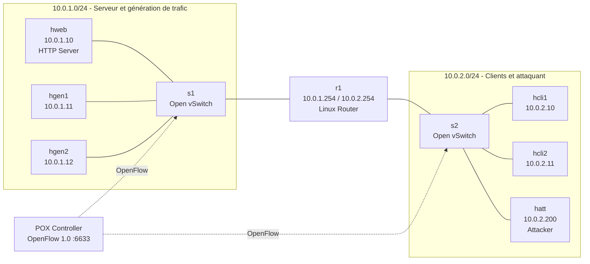
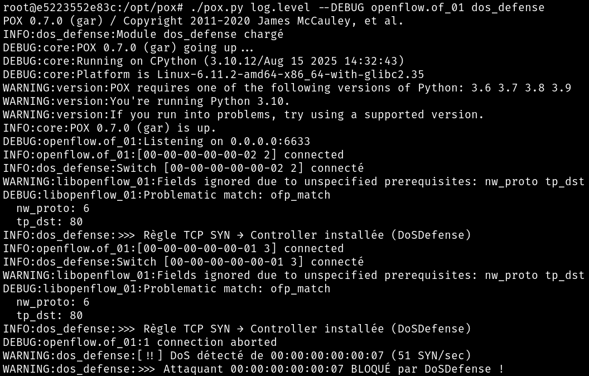
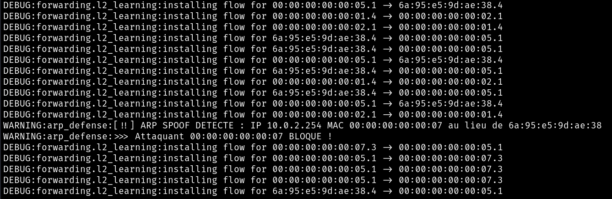

<h1 align="center">SDN Security Lab</h1>

<p align="center">
  <strong>Laboratoire de cybersécurité réseau basé sur Mininet, Open vSwitch et un contrôleur SDN POX.</strong>
</p>

<p align="center">
  Simulation de SYN Flood et d'ARP Spoofing dans un environnement Docker isolé, avec détection et mitigation dynamiques par règles OpenFlow.
</p>

<p align="center">
  
  
  
  
  
</p>

> [!WARNING]
> **Ce dépôt est un laboratoire pédagogique de cybersécurité.** Les scénarios d'attaque sont prévus uniquement pour le réseau Mininet isolé créé par ce projet. N'utilisez pas les commandes offensives présentées ici contre des systèmes, services ou réseaux réels sans autorisation explicite.

---

## À propos du projet

**SDN Security Lab** est un projet universitaire réalisé en **Master 2 CDSI - 2025/2026**, autour de la privacité et de la sécurité des données.

L'objectif est de construire un réseau reproductible dans lequel il est possible d'observer le comportement d'attaques réseau, puis de montrer comment un contrôleur **Software-Defined Networking (SDN)** peut centraliser la détection et déployer automatiquement une contre-mesure au niveau des switches.

Le laboratoire repose sur deux conteneurs Docker :

- un conteneur **Mininet + Open vSwitch** chargé d'émuler le réseau, les hôtes, le routeur et la machine attaquante ;
- un conteneur **POX** jouant le rôle de contrôleur SDN distant et exécutant les modules de défense.

Deux scénarios sont étudiés :

- **SYN Flood / DoS** contre un serveur HTTP ;
- **ARP Spoofing** afin de détourner le trafic entre les clients et leur passerelle.

Pour chacun, le dépôt permet de comparer le comportement du réseau **sans protection** puis **avec détection et blocage OpenFlow**.

---

## Fonctionnalités principales

- **Topologie Mininet multi-sous-réseaux** entièrement reproductible.
- **Deux switches OpenFlow 1.0** reliés à un contrôleur POX distant.
- **Routeur Linux** assurant l'interconnexion entre les deux zones réseau.
- **Serveur HTTP**, générateurs de trafic, clients légitimes et hôte attaquant dédiés.
- Mode **baseline** avec simple apprentissage L2 pour observer le comportement sans contre-mesure.
- Détection d'un **SYN Flood** par comptage des paquets SYN par adresse MAC dans une fenêtre temporelle.
- **Blacklist automatique** d'une source dépassant le seuil configuré.
- Installation dynamique d'une règle OpenFlow **DROP haute priorité** pour isoler la source détectée.
- Surveillance des annonces **ARP** par le contrôleur.
- Détection d'une incohérence entre une adresse IP déjà apprise et une nouvelle adresse MAC.
- Blocage OpenFlow de la MAC identifiée lors d'un **ARP Spoofing**.
- Environnement conteneurisé afin de conserver les manipulations dans un laboratoire isolé.

---

## Topologie réseau



| Hôte | Adresse | Rôle |
|---|---|---|
| `hweb` | `10.0.1.10/24` | Serveur HTTP ciblé par le scénario DoS |
| `hgen1` | `10.0.1.11/24` | Générateur de trafic légitime |
| `hgen2` | `10.0.1.12/24` | Générateur de trafic légitime |
| `r1` | `10.0.1.254/24` + `10.0.2.254/24` | Routeur Linux entre les deux sous-réseaux |
| `hcli1` | `10.0.2.10/24` | Client HTTP légitime |
| `hcli2` | `10.0.2.11/24` | Client HTTP légitime |
| `hatt` | `10.0.2.200/24` | Hôte utilisé pour les scénarios offensifs |

---

## Architecture du laboratoire

```text
SDN-Security-Lab/
├── controllers/
│   ├── arp_defense.py
│   └── dos_defense.py
├── topology/
│   └── topology.py
├── docker/
│   ├── mininet/
│   │   ├── Dockerfile
│   │   └── start-ovs.sh
│   └── pox/
│       ├── Dockerfile
│       └── run-controller.sh
├── docs/
│   └── screenshots/
│       ├── arp-spoofing-detection.png
│       └── dos-detection.png
├── docker-compose.yml
├── .dockerignore
├── .gitattributes
├── .gitignore
└── README.md
```

### Responsabilités

| Composant | Rôle |
|---|---|
| `topology/topology.py` | Construit les deux sous-réseaux Mininet, les switches, les hôtes et le routeur |
| `controllers/dos_defense.py` | Inspecte le trafic HTTP/TCP, compte les SYN et bloque une source dépassant le seuil |
| `controllers/arp_defense.py` | Apprend les associations IP/MAC observées, détecte une incohérence et bloque la MAC suspecte |
| `docker/mininet/` | Image de laboratoire contenant Mininet, Open vSwitch, `hping3`, `arpspoof`, `tcpdump`, `curl`, etc. |
| `docker/pox/` | Image du contrôleur POX et script de sélection du mode de contrôle |
| `docker-compose.yml` | Place Mininet et POX sur un réseau Docker commun et démarre l'environnement |

---

## Prérequis

Le laboratoire repose sur des fonctionnalités réseau bas niveau. L'environnement recommandé est :

- **Linux** ou une VM Linux ;
- Docker Engine ;
- Docker Compose v2 ;
- Git.

> [!NOTE]
> Le conteneur Mininet utilise le mode `privileged`. Selon la configuration, Docker Desktop sous Windows/macOS peut être plus contraignant pour Mininet/Open vSwitch qu'un hôte Linux natif ou une VM Linux.

Vérification :

```bash
docker --version
docker compose version
```

---

## Installation

```bash
git clone https://github.com/ge-xe/SDN-Security-Lab.git
cd SDN-Security-Lab
```

Construire les deux images :

```bash
docker compose build
```

Démarrer les conteneurs :

```bash
docker compose up -d
```

Vérifier leur état :

```bash
docker compose ps
```

---

## Lancer la topologie

Le contrôleur doit être actif avant le démarrage de Mininet.

Dans un premier terminal, démarrer POX en mode baseline :

```bash
docker compose exec pox run-controller baseline
```

Dans un second terminal :

```bash
docker compose exec mininet python3 /opt/lab/topology.py
```

Après le test de connectivité initial, l'invite `mininet>` apparaît.

Démarrer un serveur HTTP sur `hweb` :

```text
mininet> hweb python3 -m http.server 80 >/tmp/http.log 2>&1 &
```

Puis vérifier l'accès depuis un client légitime :

```text
mininet> hcli1 curl -I http://10.0.1.10
```

---

## Modes du contrôleur POX

Le script `run-controller` fournit trois modes :

| Mode | Commande | Utilisation |
|---|---|---|
| Baseline | `run-controller baseline` | Apprentissage L2 sans module de défense |
| DoS | `run-controller dos` | Apprentissage L2 + détection/mitigation SYN Flood |
| ARP | `run-controller arp` | Apprentissage L2 + détection/mitigation ARP Spoofing |

Pour changer de scénario, quitter la topologie Mininet avec `exit`, arrêter POX avec `Ctrl+C`, puis relancer le contrôleur dans le mode souhaité avant de redémarrer `topology.py`.

---

## Scénario 1 - SYN Flood / DoS

### Sans protection

Lancer POX en mode baseline :

```bash
docker compose exec pox run-controller baseline
```

Puis lancer la topologie et le serveur HTTP.

Dans la CLI Mininet, générer un SYN Flood depuis `hatt` :

```text
mininet> hatt hping3 -S --flood -p 80 10.0.1.10 >/tmp/hping.log 2>&1 &
```

Tester simultanément le service depuis un client légitime :

```text
mininet> hcli1 curl --max-time 3 http://10.0.1.10
```

Arrêter la génération :

```text
mininet> hatt pkill hping3
```

### Avec détection et mitigation

Relancer POX avec :

```bash
docker compose exec pox run-controller dos
```

Le module surveille le trafic TCP à destination du port 80. Pour chaque adresse MAC source, il compte les SYN observés sur une fenêtre d'une seconde. Le seuil configuré dans le projet est :

```python
THRESHOLD = 50
```

Lorsqu'une source dépasse ce seuil, son adresse MAC est ajoutée à la blacklist du contrôleur et POX pousse sur le switch une règle OpenFlow `DROP` de priorité supérieure aux règles de forwarding.

<p align="center">
  
</p>

<p align="center"><em>Exemple de détection d'un SYN Flood et blocage de la MAC source par le module DoSDefense.</em></p>

---

## Scénario 2 - ARP Spoofing

### Sans protection

Le scénario consiste à placer `hatt` entre un client du sous-réseau `10.0.2.0/24` et le routeur `10.0.2.254`.

Activer le forwarding sur l'attaquant dans le laboratoire :

```text
mininet> hatt sysctl -w net.ipv4.ip_forward=1
```

Empoisonner les deux extrémités pour `hcli1` :

```text
mininet> hatt arpspoof -i hatt-eth0 -t 10.0.2.10 10.0.2.254 >/tmp/arp-client.log 2>&1 &
mininet> hatt arpspoof -i hatt-eth0 -t 10.0.2.254 10.0.2.10 >/tmp/arp-router.log 2>&1 &
```

Pour observer le trafic HTTP dans l'environnement de test :

```text
mininet> hatt tcpdump -i hatt-eth0 -n -A port 80 -c 10 >/tmp/http-capture.txt 2>&1 &
mininet> hcli1 curl http://10.0.1.10
mininet> hatt cat /tmp/http-capture.txt
```

Arrêter les processus `arpspoof` :

```text
mininet> hatt pkill arpspoof
```

### Avec détection et mitigation

Relancer POX en mode :

```bash
docker compose exec pox run-controller arp
```

Le module `arp_defense.py` construit progressivement une table d'associations `IP -> MAC` à partir des messages ARP observés. Si une adresse IP déjà connue est annoncée par une MAC différente, le contrôleur considère cette incohérence comme une tentative d'ARP Spoofing.

La MAC suspecte est alors placée dans une blacklist et une règle OpenFlow `DROP` haute priorité est installée sur le switch.

<p align="center">
  
</p>

<p align="center"><em>Exemple de détection d'une incohérence ARP et blocage automatique de l'adresse MAC attaquante.</em></p>

---

## Fonctionnement des contre-mesures

### SYN Flood

```text
hatt envoie de nombreux SYN vers hweb:80
                  │
                  ▼
         Open vSwitch / PacketIn
                  │
                  ▼
     POX compte les SYN par MAC
                  │
          seuil > 50 / seconde
                  │
                  ▼
          MAC mise en blacklist
                  │
                  ▼
      règle OpenFlow DROP priorité 60000
```

### ARP Spoofing

```text
première annonce ARP observée
       IP A ─────────► MAC A
                       │
                       ▼
              association mémorisée
                       │
        nouvelle annonce pour IP A
                       │
                MAC B != MAC A
                       │
                       ▼
             incohérence détectée
                       │
                       ▼
             MAC B mise en blacklist
                       │
                       ▼
          règle OpenFlow DROP
```

---

## Stack technique

| Domaine | Technologies |
|---|---|
| Émulation réseau | Mininet |
| Switching | Open vSwitch |
| SDN | POX, OpenFlow 1.0 |
| Contrôleurs personnalisés | Python |
| Conteneurisation | Docker, Docker Compose |
| DoS lab | `hping3`, serveur HTTP Python, `curl` |
| ARP lab | `arpspoof` / dsniff, `tcpdump` |
| Routage | Linux IP forwarding |

---

## Choix de conception

### Contrôleur distant

POX est placé dans un conteneur séparé. Les switches Mininet se connectent au service Docker `pox` sur le port OpenFlow `6633`. Cette séparation reproduit le principe central du SDN : le plan de contrôle est distinct du plan de données.

### Inspection centralisée

Les règles installées lors de la connexion des switches forcent le trafic intéressant pour chaque scénario vers le contrôleur :

- trafic IPv4/TCP destiné au port 80 pour `dos_defense.py` ;
- trames ARP pour `arp_defense.py`.

POX peut alors analyser l'événement puis pousser une règle de blocage directement sur le switch concerné.

### Topologie dynamique

`topology.py` reconstruit l'ensemble du réseau à chaque lancement. Les hôtes utilisent des adresses déterministes afin de rendre les démonstrations reproductibles, tandis que Mininet recrée à chaque fois les namespaces, interfaces et liens virtuels.

---

## Limites du prototype

Ce projet est volontairement pédagogique et ne doit pas être interprété comme un IDS/IPS de production.

- La détection DoS repose sur un **seuil fixe de SYN par MAC** ; elle ne réalise pas d'analyse comportementale avancée.
- Le seuil `50 SYN/s` est adapté à la démonstration et n'est pas une valeur universelle pour un réseau réel.
- La défense ARP applique une stratégie **first-seen wins** : la première association IP/MAC observée devient la référence. Un système de production utiliserait une source de vérité plus robuste.
- La blacklist est conservée uniquement en mémoire tant que le contrôleur est lancé.
- Le laboratoire utilise **OpenFlow 1.0** et POX pour rester volontairement simple et lisible.
- Mininet et Open vSwitch nécessitent des privilèges réseau élevés dans le conteneur.

Ces limites font partie de l'intérêt pédagogique du projet : elles permettent de comprendre le mécanisme d'une contre-mesure SDN simple avant d'envisager des approches plus avancées.

---

## Arrêter et nettoyer le laboratoire

Quitter Mininet :

```text
mininet> exit
```

Puis :

```bash
docker compose down
```

Pour reconstruire complètement les images :

```bash
docker compose build --no-cache
```

---

## Pistes d'évolution

- Remplacer le seuil fixe par une détection fondée sur des métriques glissantes ou des statistiques de flux.
- Conserver les événements et blacklists dans une base ou un journal structuré.
- Ajouter une durée d'expiration aux règles de quarantaine.
- Construire une table ARP de confiance à partir d'une configuration déclarative plutôt que par premier apprentissage.
- Ajouter une interface de visualisation des événements de sécurité et des règles OpenFlow actives.
- Étendre la topologie à plusieurs sources d'attaque afin d'étudier un scénario DDoS réel.
- Comparer POX/OpenFlow 1.0 à un contrôleur SDN et une version d'OpenFlow plus récents.
- Ajouter des tests automatisés permettant de vérifier les scénarios d'attaque et de mitigation.

---

## Contexte académique

Ce dépôt reprend le code du projet universitaire en le restructurant sous la forme d'un laboratoire reproductible et documenté pour GitHub. Le rapport académique d'origine n'est volontairement **pas distribué dans ce dépôt** ; seules deux captures techniques issues des expérimentations sont conservées pour illustrer les résultats.
